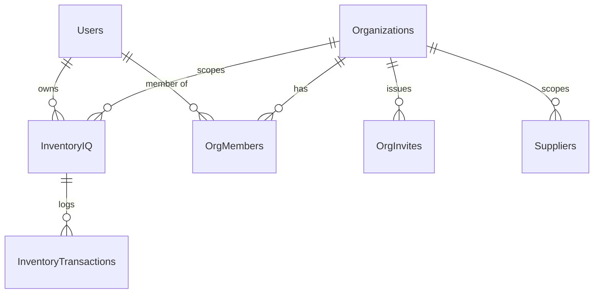

# ARCHITECTURE.md — InventoryIQ

> The structural map: how the system fits together and *why*.
> Not the rules — those live in [AGENTS.md](AGENTS.md); this file links there.
> Short on context? [ARCHITECTURE-ESSENTIALS.md](ARCHITECTURE-ESSENTIALS.md)
> is the read-first subset.
>
> Authoritative sources, in order: `lambda/` source for actual behavior,
> this file's table 4 for the DynamoDB schema, `AGENTS.md` §4 for conventions.

---

## 1. System Overview

Serverless multi-tenant inventory management system on AWS. Static S3
frontend calls a proxy Lambda that verifies identity/tenancy, then forwards
to a second, API-key-protected API Gateway stage fronting the business-logic
Lambdas.

```mermaid
flowchart LR
    B[Browser<br/>sessionStorage.sessionToken] -->|X-Session-Token, HTTPS| PG[API Gateway<br/>/prod/proxy/{proxy+}]
    PG --> P[Proxy.py]
    P -->|verify JWT stdlib hmac| P
    P -->|X-IQ-Org present: live membership lookup| OM[(OrgMembers table)]
    P -->|inject x-iq-user/org/role<br/>+ backend x-api-key| RG[API Gateway<br/>/prod/*]
    RG --> L[Authentication.mjs · Python CRUD/org Lambdas]
    L --> SQS[SQS/SNS alerts]
```

## 2. Tech Stack

| Layer | Technology | Notes |
|---|---|---|
| Frontend | Static S3, plain HTML, vanilla ESM JS, vanilla CSS | No framework/build step |
| Edge auth | `Proxy.py` (Python Lambda) | JWT verify, org membership check, header injection |
| API authorizer | `Authorizer.mjs` (Node) | API Gateway TOKEN authorizer, stdlib crypto only |
| Business logic | Python + Node ESM Lambdas | See `lambda/` |
| Data store | DynamoDB | See §4 |
| Async | SQS / SNS | Alerts, daily summaries |
| Error tracking | Sentry (`@sentry/aws-serverless` Node, `sentry-sdk` Python) | Never removed from a handler |
| E2E testing | Playwright | Only test layer — no unit suite |

## 3. Application Architecture

**Directory layout:**

```
├── frontend/     Static S3 assets: plain HTML, vanilla ESM JS, vanilla CSS
├── lambda/       Standalone Lambdas (Python + Node ESM); python_vendor/ = bundled pip deps
├── scripts/      Operational one-shots (migrate_orgs.py)
├── docs/         PRDs and design artifacts
├── tests/        Playwright E2E (page objects in tests/pages/)
└── playwright.config.ts
```

**API style:** REST via API Gateway + Lambda, two-stage (proxy stage → real
stage). No tRPC/GraphQL. Every mutation follows: JWT/membership check (in
`Proxy.py`, before the real Lambda runs) → RBAC check (`_org.has_role()` in
the Lambda) → item write + audit log write in one `TransactWriteItems`.

**Auth model (JWT, stateless):**

- `Authentication.mjs` signs an HS256 JWT on login (`sub` = lowercased email).
  Client stores it in `sessionStorage.sessionToken`.
- Validation is stateless — `Proxy.py` and `Authorizer.mjs` verify the
  signature with stdlib crypto only. No external JWT library anywhere.
- `JWT_SECRET` env var must match across `Authentication`, `Proxy`, and
  `Authorizer` Lambdas or all logins 401.
- The `Sessions` table is audit-trail + logout cleanup only — never used for
  token validation.

**RBAC:** `ROLE_RANK = viewer 1 < editor 2 < admin 3 < owner 4`, checked with
`has_role(have, need)`. Exactly one owner per org. Seat cap via
`ORG_SEAT_CAP` (default 5). Role is looked up live per request
(`_org.get_membership`), never cached in the token, so removal is instant.

**Backend Lambda catalog:** see `AGENTS.md` §2 for the full annotated list
(`AddItem.py`, `GetAllItems.py`, `UpdateItem.py`, `DeleteItem.py`/
`RestoreItem.py`/`PurgeDeletedItems.py`, `GetCategories.py`,
`GetTransactions.py`, `LowItemInsight.py`, `Forecast.py`, `BulkImport*.py`,
`BarcodeLookup.py`, `Suppliers.py`, `CascadeDeleteUser.py`, `DailyAlert.py`,
`Orgs.py`, `OrgMembers.py`, `OrgInvites.py`, `_org.py`, `_logging.py`).

**Frontend catalog:** see `AGENTS.md` §2 for the full annotated page list
(`login.html`, `dashboard.html`, `inventory.html`, `add-item.html`,
`insights.html`, `forecast.html`, `suppliers.html`, `transactions.html`,
plus shared `api.js`/`utils.js`/`charts.js`/`config.js`).

## 4. Data Model

| Table | PK | SK | GSIs | TTL | Notes |
|---|---|---|---|---|---|
| `InventoryIQ` | `itemID` | — | `userID-index`, `orgID-index` | — | Items: `name`, `category`, `quantity`, `price` (Decimal), `lowStockThreshold`, `userID`, `orgID`, `barcode`, `version`, timestamps, `deletedAt`/`deletedBy` |
| `Users` | `Email` | — | — | — | `passwordHash` (scrypt), `salt`. Streams on — REMOVE triggers `CascadeDeleteUser` |
| `Sessions` | `sessionToken` | — | `userID-index` | `expiresAt` | Audit trail + logout cleanup only |
| `AuthAttempts` | `email` | — | — | `ttl` | Failed-login rate limiting, 15-min lockout |
| `PasswordResets` | `resetToken` | — | — | `expiresAt` | Single-use reset tokens |
| `InventoryTransactions` | `transactionID` | — | `orgID-index` | — | Audit trail: `changeType`, before/after/delta quantities |
| `IdempotencyKeys` | `key` | — | — | `expiresAt` | 24h replay cache |
| `Suppliers` | `supplierID` | — | `userID-index`, `orgID-index` | — | Supplier records |
| `Organizations` | `orgID` | — | — | — | `name`, `memberCount`, soft-delete via `deletedAt` |
| `OrgMembers` | `orgID` | `userID` | `userID-index` | — | `role`, `status` — the live-lookup table for instant revoke |
| `OrgInvites` | `inviteTokenHash` | — | `orgID-index`, `email-index` | — | SHA-256 of invite token, `role`, invited email |



## 5. Auth & Authorization

Two enforcement layers, drawing different lines:

1. **Identity/session validity** — stateless JWT verified by `Proxy.py`/
   `Authorizer.mjs`. Answers "is this a valid logged-in user?"
2. **Tenancy/role** — live `OrgMembers` lookup + `ROLE_RANK` comparison.
   Answers "can this user do this action in this org?"

Never conflate the two: a valid JWT does not imply org membership or role
sufficiency: that's a second, per-request check.

## 6. Cross-Cutting Concerns

- **Idempotency:** writes honor `Idempotency-Key`, replaying the cached
  response within 24h instead of re-running business logic.
- **Optimistic locking:** items start at `version: 1`; updates require
  `If-Match`, mismatch → 412, success increments version, returned as `ETag`.
- **Soft-deletes:** `DeleteItem` sets `deletedAt`/`deletedBy`, never purges.
  Reads filter `deletedAt`. `PurgeDeletedItems` sweeps after 30 days.
- **Cascade deletes:** removing a `Users` record fires `CascadeDeleteUser`
  via DynamoDB Streams across all user-owned tables.
- **Scheduled jobs:** `DailyAlert.py` (daily SNS stock summary),
  `PurgeDeletedItems.py` (30-day sweep).
- **Error tracking:** Sentry via `_logging.capture_error` (Python) /
  `Sentry.wrapHandler` (Node) — never let a handler swallow an exception
  without it.

## 7. Testing

| Layer | Location | Runner |
|---|---|---|
| E2E (only layer) | `tests/e2e/`, page objects in `tests/pages/` | Playwright, config `playwright.config.ts` |

No unit test suite — E2E against live AWS endpoints is the coverage
strategy. See `AGENTS.md` §5 for commands and the proxy-route requirement.

## 8. Where to Look

| Question | File |
|---|---|
| How does auth/JWT work? | `lambda/Proxy.py`, `lambda/Authorizer.mjs`, `lambda/Authentication.mjs` |
| How is tenancy/RBAC enforced? | `lambda/_org.py` |
| What's the DynamoDB schema? | §4 above |
| How does an item mutation work end to end? | `lambda/AddItem.py` / `lambda/UpdateItem.py` |
| How does the frontend call the API? | `frontend/api.js`, `frontend/config.js` |
| What are the theme/design tokens? | `AGENTS.md` §4.C |
| How do I run tests? | `AGENTS.md` §5 |
